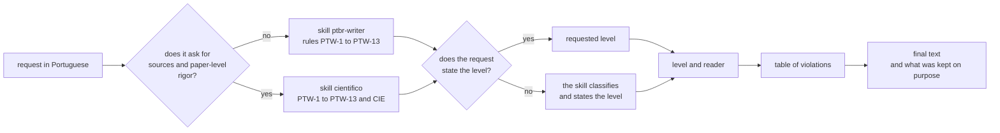

<div align="center">


# ptbr-writer

<sub><a href="#install">install</a> · <a href="#use">use</a> · <a href="#levels">levels</a> · <a href="#rules">rules</a> · <a href="#roadmap">roadmap</a> · <a href="#development">development</a> · <a href="#credits">credits</a> · <a href="CHANGELOG.md">versions</a> · <a href="https://h0ffmann.github.io/ptbr-writer/">the site</a></sub>

[](https://github.com/h0ffmann/ptbr-writer/actions/workflows/site.yml)
[](https://github.com/h0ffmann/ptbr-writer/releases/tag/v0.2.0)
[](#license)
[](#install)

</div>

🇧🇷 [Leia em português](https://github.com/h0ffmann/ptbr-writer/blob/main/README.md) · this is the English version

## in one minute

- **It rewrites technical text in Brazilian Portuguese for a single read:** explicit subject, one
  proposition per sentence, consistent terms. It serves text that humans and agents read.
- **Every request goes through a level of rigor** (`estrito`, `descritivo`, `leve`, `científico`,
  `smart-note`), and the skill states the level it assumed.
- **It does not change thesis, authorship or conclusion, and it does not look up sources.** It marks
  with `⚠` what it did not check. Goal: keep a repository's PT-BR and EN documentation while
  spending fewer tokens.



<details open>
<summary>How to read this figure</summary>

**Takeaway.** The request enters through one of two skills, gets a level of rigor and leaves as
final text, with the list of what was changed.

**How to read.** Left to right. A diamond is a question, with both exits labelled; a rectangle is a
step. Both skills apply the same PTW rules; `cientifico` adds the CIE rules.

**Not shown.** The `smart-note` level (it combines with another level and delivers `RAW` and
`nota`), the `⚠` list of the `científico` level, and the routing skill `ptbr-routing`, which is
outside the plugin.

**Evidence.** Output format: the "Formato de saída" section of [`SKILL.md`](SKILL.md). Scientific
skill: [`skills/cientifico/SKILL.md`](skills/cientifico/SKILL.md). Plugin skills:
[`plugins/ptbr-writer/skills/`](plugins/ptbr-writer/skills) (`ptbr-writer`, `ptbr`,
`cientifico`). Whether Claude picks `cientifico` by itself, from its description, was not
measured ⚠.

</details>

## install

The official version is **[v0.2.0](https://github.com/h0ffmann/ptbr-writer/releases/tag/v0.2.0)**.
Install by tag: the plugin changes only when you change the tag. One line, in a terminal:

```console
claude plugin install ptbr-writer --marketplace h0ffmann/ptbr-writer#v0.2.0
```

Or, inside Claude Code:

```console
/plugin marketplace add h0ffmann/ptbr-writer#v0.2.0
/plugin install ptbr-writer@ptbr-writer
```

For everyone who opens a repository to use the same version, put this in its `.claude/settings.json`:

```json
{
  "extraKnownMarketplaces": {
    "ptbr-writer": {
      "source": { "source": "github", "repo": "h0ffmann/ptbr-writer", "ref": "v0.2.0" }
    }
  },
  "enabledPlugins": { "ptbr-writer@ptbr-writer": true }
}
```

**Update:** change the tag (`/plugin marketplace remove ptbr-writer` and `add` again; in a
repository, the `ref`). What changes in each version is in [`CHANGELOG.md`](CHANGELOG.md).

## use

| Command | Does |
| :------ | :--- |
| `/ptbr-writer:ptbr` | rewrites at the requested level, or classifies the text and states the level |
| `/ptbr-writer:ptbr-writer` | the same, with the full name |
| `/ptbr-writer:cientifico` | scientific text with sources: paper, proposal, report (CIE rules) |

Or describe the task: "reescreva este runbook em português controlado".

From v0.2.0, a request that starts with `ptbr` ("ptbr: reescreva este texto", `/ptbr`) uses
`ptbr-writer.toml`. Naming ptbr-writer inside a sentence triggers nothing. The first time, with no
such file, Claude asks once, multiple choice:

- **levels:** one text per level;
- **formats:** `.txt`, `.md`, `.pdf` and `notes` (smart-note);
- **folder:** the session root (the default), `docs/`, or another one, typed in;
- **languages:** pt-BR (the default) and/or ASD-STE100, Simplified Technical English; one text per language.

and writes the answers to `./ptbr-writer.toml`. From then on it does not ask: edit the file, or
write `ptbr reconfigurar`.

```toml
levels = ["estrito"]     # empty: the skill classifies and states the level
formats = ["md", "pdf"]  # txt, md, pdf, notes; empty: only the answer
folder = "docs"          # relative to the session root, no ".."
print = ["txt", "md"]    # shown in full in the console, besides the file
languages = ["pt-BR"]    # and/or "asd-ste100"; the ASD-STE100 file ends in -ste100
```

Each layer overrides the one before: the plugin's defaults
([`ptbr-writer.default.toml`](plugins/ptbr-writer/ptbr-writer.default.toml)),
`~/.config/ptbr-writer/ptbr-writer.toml`, `./ptbr-writer.toml` and, last, the request
(`ptbr leve: ...` uses `leve`). An unknown value or a folder outside the root is ignored, with a
warning. Files share one name pattern:

```text
ptbr-writer-<YYYYMMDDThhmmZ>-<goal>-<level>.<ext>
ptbr-writer-20261020T2215Z-reinicio-servico-estrito.md
```

The timestamp is UTC and the same for every file of one request. Two levels in three formats make
six files. So a `git add -A` does not pick them up, add `ptbr-writer-*` to `.gitignore`. Notes from
`notes` follow the smart-note rules (`<id>-<slug>.md`). `.pdf` uses the machine's pandoc.
Without it, Claude asks before downloading, through Nix, picasso's
[`labs/ptbr-pdf`](https://github.com/h0ffmann/picasso/tree/main/labs/ptbr-pdf) (a Rust binary,
`to-pdf`, with Typst and fonts embedded). The binary is not in cache.nixos.org yet: Nix compiles it
from source. Measured with `just pdf-bench` (x86_64-linux), at picasso v0.2.0, with the slim
binary ([run](https://github.com/h0ffmann/ptbr-writer/actions/runs/39537436728)):

| download | on disk | built on the machine | first run, fresh GitHub runner (4 cores) |
| :------- | :------ | :------------------- | :--------------------------------------- |
| 14 MiB, 6 paths from cache.nixos.org | 72 MiB, 7 paths | 25 MiB, 1 path (`to-pdf`, compiled) | 892 s (15 min) |

The time depends on the network. From the second run on, Nix reuses the store.

## levels

| Level | Use |
| :---- | :-- |
| `estrito` | runbooks, procedures, outputs for agents |
| `descritivo` | system documentation |
| `leve` | internal announcements |
| `científico` | papers, proposals, technical reports with sources |
| `smart-note` | notes for a second brain; combines with another level (`smart-note + estrito`) |

Planned, outside `SKILL.md` and with no context cost: `retórico`, `ensaístico`, `crônico`,
`anedótico`, `machado-writer`, `saramago-writer` (source: [`site/data/planned.tsv`](site/data/planned.tsv)).

> [!WARNING]
> An author level imitates style and never copies text. Citation and public-domain rules are in
> [`REUSE.md`](REUSE.md).

## rules

The text of each rule is in [`SKILL.md`](SKILL.md) and [on the site](https://h0ffmann.github.io/ptbr-writer/#regras).
The origin of each one comes from [`site/data/origins.tsv`](site/data/origins.tsv). The
`cientifico` skill applies PTW-1 to PTW-13 and adds CIE-1 to CIE-12.

| id | rule | origin | creator |
| :- | :--- | :----- | :------ |
| PTW-1 | Quem faz, aparece (the actor appears) | PTC-1 | [@kayquer](https://github.com/kayquer) |
| PTW-2 | Uma proposição por frase (one proposition per sentence) | PTC-2 | [@kayquer](https://github.com/kayquer) |
| PTW-3 | Modalidade e quantidade explícitas (explicit modality and quantity) | PTC-3 | [@kayquer](https://github.com/kayquer) |
| PTW-4 | Verbo pleno (full verb) | PTC-4 | [@kayquer](https://github.com/kayquer) |
| PTW-5 | Sintaxe plana (flat syntax) | PTC-5 | [@kayquer](https://github.com/kayquer) |
| PTW-6 | Termos congelados (frozen terms) | PTC-6 | [@kayquer](https://github.com/kayquer) |
| PTW-7 | Números, datas e unidades (numbers, dates and units) | PTC-7 | [@kayquer](https://github.com/kayquer) |
| PTW-8 | Ortografia PT-BR vigente (current PT-BR spelling) | PTC-8 | [@kayquer](https://github.com/kayquer) |
| PTW-9 | Toda afirmação tem marca (every claim has a mark) | ouro-paper; Audience and evidence | [@h0ffmann](https://github.com/h0ffmann) |
| PTW-10 | Nenhuma referência inventada (no invented reference) | ouro-paper | [@h0ffmann](https://github.com/h0ffmann) |
| PTW-11 | Número com unidade e origem (a number with unit and origin) | ouro-paper; Audience and evidence | [@h0ffmann](https://github.com/h0ffmann) |
| PTW-12 | Sem alegação de pioneirismo (no priority claim) | Vale style `PriorityClaims` | [@h0ffmann](https://github.com/h0ffmann) |
| PTW-13 | Fato separado de análise (fact apart from analysis) | ouro-paper | [@h0ffmann](https://github.com/h0ffmann) |

## roadmap

Source: [`site/data/roadmap.tsv`](site/data/roadmap.tsv). The first column keeps the Portuguese names
that the site and the README guard read.

| Piece | Status | What is missing or what exists |
| :---- | :----- | :----------------------------- |
| [`SKILL.md`](SKILL.md) | in progress | PTW rules and levels of rigor; the rules are still marked as in development |
| [`evals/`](evals/cientifico.md) | in progress | regression cases written, not yet run by a harness ⚠ |
| [skill científica](skills/cientifico/SKILL.md) | in progress | CIE rules; cases in `evals/cientifico-cie.md`, not yet run ⚠ |
| [roteamento](skills/ptbr-routing/SKILL.md) | done | `route` picks the skill and the level before a skill loads |
| [plugin](plugins/ptbr-writer/.claude-plugin/plugin.json) | done | Claude Code plugin, installed with one command at the release version; OpenCode reads `SKILL.md` directly |
| [distribuição](CHANGELOG.md) | done | release by tag with `just release`; v0.2.0 is the official version, installed by tag |
| [retórica](skills/retorica/SKILL.md) | planned | only the skeleton, no rules |

## awesome-ptbr-writer

Other projects for people who write technical text in Portuguese (source: [`site/data/awesome.tsv`](site/data/awesome.tsv)).

| Repository | What it gives |
| :--------- | :------------ |
| [kayquer/portugues-tecnico-controlado](https://github.com/kayquer/portugues-tecnico-controlado) | the original: 8 rules of controlled technical Portuguese |
| [fabricioctelles/skills](https://github.com/fabricioctelles/skills) | "humanizar" skill: removes AI-text patterns in pt-BR |
| [vale-cli/vale](https://github.com/vale-cli/vale) | prose linter with its own styles |
| [languagetool-org/languagetool](https://github.com/languagetool-org/languagetool) | grammar and style checker with pt-BR |
| [hunspell/hunspell](https://github.com/hunspell/hunspell) | spell checking with pt-BR dictionaries |
| [ajdavidl/Portuguese-NLP](https://github.com/ajdavidl/Portuguese-NLP) | index of NLP resources for Portuguese |

## development

Requirements: [Nix](https://nixos.org/download/) with flakes. Rules for agents and contributors:
[`AGENTS.md`](AGENTS.md).

```console
nix develop           # the development shell
just quality          # everything CI checks, including the README
just site             # the site in site/dist
just release-due      # did the plugin change since the last tag?
```

Without Claude Code (OpenCode or another agent that reads skills): copy [`SKILL.md`](SKILL.md) to
the agent's skills folder.

## credits

- Rules PTW-1 to PTW-8: the PTC by [@kayquer](https://github.com/kayquer) (MIT).
- PTW-9 to PTW-13: the `ouro-paper` skill and the `.vale/styles/research` style of
  [marola-dev/marola-research](https://github.com/marola-dev/marola-research) (`041cedd`), and
  "Audience and evidence" of [h0ffmann/ww3-gpu](https://github.com/h0ffmann/ww3-gpu) (`319e4e2`).
- Scientific skill: `scientific-writing` by
  [K-Dense-AI/scientific-agent-skills](https://github.com/K-Dense-AI/scientific-agent-skills/tree/a1043ef544e3a100c28e70a736b6cf32554d0677/skills/scientific-writing)
  (`a1043ef`, MIT, Copyright (c) 2025 K-Dense Inc.) and `artigo` by
  [labdaps/labskills](https://github.com/labdaps/labskills/tree/246c1646a51a5a754aedf786fef0544d528064e7/skills/artigo)
  (`246c164`, MIT, Copyright (c) 2026 LABDAPS), in our own words. Requested citation: Kassis, T.,
  Agarwal, V., He, Y., Patel, D., & Brueckner, A. M. (2026). *Scientific Agent Skills: A Library of
  Procedural Knowledge for Research Agents*. arXiv:2609.00065.
  <https://doi.org/10.48550/arXiv.2609.00065>. The CIE rules on nothing invented and on the human
  deciding also come from the invariants of [h0ffmann/closed-source](https://github.com/h0ffmann/closed-source)
  (`563c339`) and of [ouroboric-dev/ouroboric](https://github.com/ouroboric-dev/ouroboric) (`2858c11`).
- smart-note: *How to Take Smart Notes*, by Sönke Ahrens; Niklas Luhmann's Zettelkasten; Robert M.
  Pirsig's card file for *Lila* ⚠.
- Rhetoric: the epigraph is from Pirsig, *Zen and the Art of Motorcycle Maintenance* (1974), checked
  against two public reproductions, not the printed edition ⚠. Basis: Plato's *Phaedo* and *Phaedrus*.
- Author level: the skill [orwell-writing](https://github.com/tamdogood/builder-essential-skills/tree/1be9984/skills/orwell-writing), by @tamdogood (MIT).
- Plugin and routing in the mould of the plugin and the `routing` skill of [marola-dev/marola-devkit](https://github.com/marola-dev/marola-devkit),
  by [@brunogbv](https://github.com/brunogbv).
  README layout: [h0ffmann/picasso](https://github.com/h0ffmann/picasso) and ww3-gpu. Site stack:
  closed-source and ww3-gpu; Lustre (MIT) and the Gleam stdlib (Apache-2.0) only at build time;
  Google Fonts (SIL OFL); the flag and signature of Machado de Assis from Wikimedia Commons, in the
  public domain.

## license

MIT. See [`LICENSE`](LICENSE).

<sub>ptbr-writer is a conceptual, independent fork of <a href="https://github.com/kayquer/portugues-tecnico-controlado">Português Técnico Controlado (PTC)</a>, by <a href="https://github.com/kayquer">kayquer</a> (MIT). The original methodology and rules are from there.</sub>
