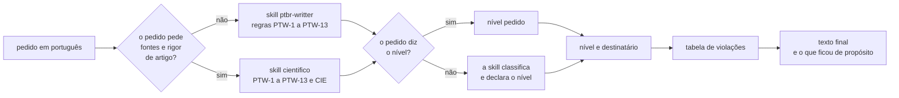

<div align="center">


# ptbr-writter

<sub><a href="#instalar">instalar</a> · <a href="#usar">usar</a> · <a href="#níveis">níveis</a> · <a href="#regras">regras</a> · <a href="#roadmap">roadmap</a> · <a href="#desenvolvimento">desenvolvimento</a> · <a href="#créditos">créditos</a> · <a href="CHANGELOG.md">versões</a> · <a href="https://h0ffmann.github.io/ptbr-writter/">o site</a></sub>

[](https://github.com/h0ffmann/ptbr-writter/actions/workflows/site.yml)
[](https://github.com/h0ffmann/ptbr-writter/releases/tag/v0.1.0)
[](#licença)
[](#instalar)

</div>

🇬🇧 [Read in English](https://github.com/h0ffmann/ptbr-writter/blob/main/README.en.md)

## em um minuto

- **Reescreve texto técnico em português brasileiro para leitura única:** sujeito explícito, uma
  proposição por frase, termos consistentes. Serve a texto que humanos e agentes leem.
- **Cada pedido passa por um nível de rigor** (`estrito`, `descritivo`, `leve`, `científico`,
  `smart-note`), e a skill declara o nível que assumiu.
- **Não muda tese, autoria nem conclusão, e não busca fontes.** Marca com `⚠` o que não checou.
  Objetivo: manter a documentação PT-BR e EN de um repositório gastando menos tokens.



<details open>
<summary>Como ler esta figura</summary>

**Em uma frase.** O pedido entra por uma de duas skills, ganha um nível de rigor e sai como texto
final, com a lista do que foi trocado.

**Como ler.** Da esquerda para a direita. Losango é uma pergunta, com as duas saídas rotuladas;
retângulo é um passo. As duas skills aplicam as mesmas regras PTW; a `cientifico` acrescenta as CIE.

**Fora da figura.** O nível `smart-note` (que combina com outro nível e entrega `RAW` e `nota`), a
lista de `⚠` do nível `científico` e a skill de roteamento `ptbr-routing`, que fica fora do plugin.

**Evidência.** Formato de saída: seção "Formato de saída" da [`SKILL.md`](SKILL.md). Skill científica:
[`skills/cientifico/SKILL.md`](skills/cientifico/SKILL.md). Skills do plugin:
[`plugins/ptbr-writter/skills/`](plugins/ptbr-writter/skills) (`ptbr-writter`, `ptbr`,
`cientifico`). Quando o Claude escolhe a `cientifico` sozinho, pela descrição dela, não foi medido ⚠.

</details>

## instalar

A versão oficial é a **[v0.1.0](https://github.com/h0ffmann/ptbr-writter/releases/tag/v0.1.0)**.
Instale por tag: o plugin só muda quando você trocar a tag.

```console
/plugin marketplace add h0ffmann/ptbr-writter#v0.1.0
/plugin install ptbr-writter@ptbr-writter
```

Para que todo mundo que abre um repositório use a mesma versão, ponha isto no `.claude/settings.json`
dele:

```json
{
  "extraKnownMarketplaces": {
    "ptbr-writter": {
      "source": { "source": "github", "repo": "h0ffmann/ptbr-writter", "ref": "v0.1.0" }
    }
  },
  "enabledPlugins": { "ptbr-writter@ptbr-writter": true }
}
```

**Atualizar:** troque a tag (`/plugin marketplace remove ptbr-writter` e o `add` de novo; num
repositório, o `ref`). O que muda em cada versão está no [`CHANGELOG.md`](CHANGELOG.md).

## usar

| Comando | Faz |
| :------ | :-- |
| `/ptbr-writter:ptbr` | reescreve no nível pedido, ou classifica o texto e declara o nível |
| `/ptbr-writter:ptbr-writter` | o mesmo, com o nome completo |
| `/ptbr-writter:cientifico` | texto científico com fontes: artigo, proposta, relatório (regras CIE) |

Ou descreva a tarefa: "reescreva este runbook em português controlado".

A partir da v0.2.0, um pedido que começa com `ptbr` ("ptbr: reescreva este texto", `/ptbr`)
usa o `ptbr-writter.toml`. Citar ptbr-writter no meio de uma frase não dispara nada. Na primeira
vez, sem esse arquivo, o Claude pergunta uma vez só, em múltipla escolha:

- **níveis:** um texto por nível;
- **formatos:** `.txt`, `.md`, `.pdf` e `notes` (smart-note);
- **pasta:** a raiz da sessão (o padrão), `docs/` ou outra, digitada.

e grava as respostas em `./ptbr-writter.toml`. Daí em diante não pergunta mais: edite o arquivo,
ou escreva `ptbr reconfigurar`.

```toml
levels = ["estrito"]     # vazio: a skill classifica e declara o nível
formats = ["md", "pdf"]  # txt, md, pdf, notes; vazio: só a resposta
folder = "docs"          # relativa à raiz da sessão, sem ".."
print = ["txt", "md"]    # o que aparece inteiro no console, além do arquivo
```

Cada camada sobrescreve a anterior: os padrões do plugin
([`ptbr-writter.default.toml`](plugins/ptbr-writter/ptbr-writter.default.toml)),
`~/.config/ptbr-writter/ptbr-writter.toml`, `./ptbr-writter.toml` e, por último, o pedido
(`ptbr leve: ...` usa `leve`). Um valor desconhecido ou uma pasta fora da raiz é ignorado, com
aviso. O nome dos arquivos é um só:

```text
ptbr-writter-<AAAAMMDDThhmmZ>-<objetivo>-<nível>.<ext>
ptbr-writter-20261020T2215Z-reinicio-servico-estrito.md
```

O carimbo é em UTC e o mesmo para todos os arquivos de um pedido. Com 2 níveis e 3 formatos, são 6
arquivos. Para um `git add -A` não levá-los, ponha `ptbr-writter-*` no `.gitignore`. As notas de
`notes` seguem as regras de smart-note (`<id>-<slug>.md`). O `.pdf` usa o pandoc da máquina. Sem
ele, o Claude pergunta antes de baixar, pelo Nix, o
[`labs/ptbr-pdf`](https://github.com/h0ffmann/picasso/tree/main/labs/ptbr-pdf) do picasso (um binário Rust, `to-pdf`, com Typst e fontes embutidas). O binário ainda não está no cache.nixos.org: o Nix o compila do código-fonte. Medido com `just pdf-bench` (x86_64-linux), no picasso `e75838c`, antes do trabalho de reduzir o binário ([execução](https://github.com/h0ffmann/ptbr-writter/actions/runs/39525457779)):

| download | em disco | montado na máquina | primeira vez, runner novo do GitHub (4 núcleos) |
| :------- | :------- | :----------------- | :---------------------------------------------- |
| 14 MiB, 6 caminhos do cache.nixos.org | 94 MiB, 7 caminhos | 47 MiB, 1 caminho (o `to-pdf`, compilado) | 1029 s (17 min) |

O tempo depende da rede. Da segunda vez em diante, o Nix reusa o store.

## níveis

| Nível | Uso |
| :---- | :-- |
| `estrito` | runbooks, procedimentos, saídas para agentes |
| `descritivo` | documentação de sistema |
| `leve` | comunicados internos |
| `científico` | artigos, propostas, relatórios técnicos com fontes |
| `smart-note` | notas para um segundo cérebro; combina com outro nível (`smart-note + estrito`) |

Planejados, fora da `SKILL.md` e sem custo de contexto: `retórico`, `ensaístico`, `crônico`,
`anedótico`, `machado-writter`, `saramago-writter` (fonte: [`site/data/planned.tsv`](site/data/planned.tsv)).

> [!WARNING]
> Um nível de autor imita o estilo e nunca copia texto. Regras de citação e de domínio público em
> [`REUSE.md`](REUSE.md).

## regras

O texto de cada regra está na [`SKILL.md`](SKILL.md) e [no site](https://h0ffmann.github.io/ptbr-writter/#regras).
A origem de cada uma vem de [`site/data/origins.tsv`](site/data/origins.tsv). A skill `cientifico`
aplica PTW-1 a PTW-13 e acrescenta CIE-1 a CIE-12.

| id | regra | origem | criador |
| :- | :---- | :----- | :------ |
| PTW-1 | Quem faz, aparece | PTC-1 | [@kayquer](https://github.com/kayquer) |
| PTW-2 | Uma proposição por frase | PTC-2 | [@kayquer](https://github.com/kayquer) |
| PTW-3 | Modalidade e quantidade explícitas | PTC-3 | [@kayquer](https://github.com/kayquer) |
| PTW-4 | Verbo pleno | PTC-4 | [@kayquer](https://github.com/kayquer) |
| PTW-5 | Sintaxe plana | PTC-5 | [@kayquer](https://github.com/kayquer) |
| PTW-6 | Termos congelados | PTC-6 | [@kayquer](https://github.com/kayquer) |
| PTW-7 | Números, datas e unidades | PTC-7 | [@kayquer](https://github.com/kayquer) |
| PTW-8 | Ortografia PT-BR vigente | PTC-8 | [@kayquer](https://github.com/kayquer) |
| PTW-9 | Toda afirmação tem marca | ouro-paper; Audience and evidence | [@h0ffmann](https://github.com/h0ffmann) |
| PTW-10 | Nenhuma referência inventada | ouro-paper | [@h0ffmann](https://github.com/h0ffmann) |
| PTW-11 | Número com unidade e origem | ouro-paper; Audience and evidence | [@h0ffmann](https://github.com/h0ffmann) |
| PTW-12 | Sem alegação de pioneirismo | estilo Vale `PriorityClaims` | [@h0ffmann](https://github.com/h0ffmann) |
| PTW-13 | Fato separado de análise | ouro-paper | [@h0ffmann](https://github.com/h0ffmann) |

## roadmap

Fonte: [`site/data/roadmap.tsv`](site/data/roadmap.tsv).

| Peça | Status | O que falta ou o que há |
| :--- | :----- | :---------------------- |
| [`SKILL.md`](SKILL.md) | em andamento | regras PTW e níveis de rigor; as regras ainda estão marcadas como em desenvolvimento |
| [`evals/`](evals/cientifico.md) | em andamento | casos de regressão escritos, ainda não rodados por um harness ⚠ |
| [skill científica](skills/cientifico/SKILL.md) | em andamento | regras CIE; casos em `evals/cientifico-cie.md`, ainda não rodados ⚠ |
| [roteamento](skills/ptbr-routing/SKILL.md) | feito | `route` escolhe a skill e o nível antes de carregar uma skill |
| [plugin](plugins/ptbr-writter/.claude-plugin/plugin.json) | em andamento | plugin do Claude Code pronto; falta o OpenCode |
| [distribuição](CHANGELOG.md) | feito | release por tag com `just release`; a v0.1.0 é a versão oficial, instalada por tag |
| [retórica](skills/retorica/SKILL.md) | planejado | só o esqueleto, sem regras |

## awesome-ptbr-writter

Outros projetos para quem escreve texto técnico em português (fonte: [`site/data/awesome.tsv`](site/data/awesome.tsv)).

| Repositório | O que dá |
| :---------- | :------- |
| [kayquer/portugues-tecnico-controlado](https://github.com/kayquer/portugues-tecnico-controlado) | o original: 8 regras de português técnico controlado |
| [fabricioctelles/skills](https://github.com/fabricioctelles/skills) | skill "humanizar": remove padrões de texto de IA em pt-BR |
| [vale-cli/vale](https://github.com/vale-cli/vale) | linter de prosa com estilos próprios |
| [hunspell/hunspell](https://github.com/hunspell/hunspell) | ortografia com dicionários pt-BR |
| [ajdavidl/Portuguese-NLP](https://github.com/ajdavidl/Portuguese-NLP) | índice de recursos de PLN para português |

## desenvolvimento

Requisitos: [Nix](https://nixos.org/download/) com flakes. Regras para agentes e para quem
contribui: [`AGENTS.md`](AGENTS.md).

```console
nix develop           # o shell de desenvolvimento
just quality          # tudo o que o CI checa, inclusive este README
just site             # o site em site/dist
just release-due      # o plugin mudou desde a última tag?
```

Sem o Claude Code (OpenCode ou outro agente que lê skills): copie [`SKILL.md`](SKILL.md) para a
pasta de skills do agente.

## créditos

- Regras PTW-1 a PTW-8: o PTC de [@kayquer](https://github.com/kayquer) (MIT).
- PTW-9 a PTW-13: a skill `ouro-paper` e o estilo `.vale/styles/research` de
  [marola-dev/marola-research](https://github.com/marola-dev/marola-research) (`041cedd`) e
  "Audience and evidence" de [h0ffmann/ww3-gpu](https://github.com/h0ffmann/ww3-gpu) (`319e4e2`).
- Skill científica: `scientific-writing` de
  [K-Dense-AI/scientific-agent-skills](https://github.com/K-Dense-AI/scientific-agent-skills/tree/a1043ef544e3a100c28e70a736b6cf32554d0677/skills/scientific-writing)
  (`a1043ef`, MIT, Copyright (c) 2025 K-Dense Inc.) e `artigo` de
  [labdaps/labskills](https://github.com/labdaps/labskills/tree/246c1646a51a5a754aedf786fef0544d528064e7/skills/artigo)
  (`246c164`, MIT, Copyright (c) 2026 LABDAPS), em palavras próprias. Citação pedida: Kassis, T.,
  Agarwal, V., He, Y., Patel, D., & Brueckner, A. M. (2026). *Scientific Agent Skills: A Library of
  Procedural Knowledge for Research Agents*. arXiv:2609.00065.
  <https://doi.org/10.48550/arXiv.2609.00065>. As regras CIE de nada inventado e de humano decide
  também vêm dos invariantes de [h0ffmann/closed-source](https://github.com/h0ffmann/closed-source)
  (`563c339`) e de [ouroboric-dev/ouroboric](https://github.com/ouroboric-dev/ouroboric) (`2858c11`).
- smart-note: *How to Take Smart Notes*, de Sönke Ahrens; o Zettelkasten de Niklas Luhmann; o
  fichário de Robert M. Pirsig para *Lila* ⚠.
- Retórica: a epígrafe é de Pirsig, *Zen and the Art of Motorcycle Maintenance* (1974), conferida em
  duas reproduções públicas, não na edição impressa ⚠. Base: o *Fédon* e o *Fedro*, de Platão.
- Nível por autor: a skill [orwell-writing](https://github.com/tamdogood/builder-essential-skills/tree/1be9984/skills/orwell-writing), de @tamdogood (MIT).
- Plugin e roteamento no molde do plugin e do `routing` de [marola-dev/marola-devkit](https://github.com/marola-dev/marola-devkit),
  de [@brunogbv](https://github.com/brunogbv).
  Layout do README: [h0ffmann/picasso](https://github.com/h0ffmann/picasso) e ww3-gpu. Stack do
  site: closed-source e ww3-gpu; Lustre (MIT) e a stdlib do Gleam (Apache-2.0) só no build; fontes
  do Google Fonts (SIL OFL); bandeira e assinatura de Machado de Assis do Wikimedia Commons, em
  domínio público.

## licença

MIT. Veja [`LICENSE`](LICENSE).

<sub>ptbr-writter é um fork conceitual e independente do <a href="https://github.com/kayquer/portugues-tecnico-controlado">Português Técnico Controlado (PTC)</a>, de <a href="https://github.com/kayquer">kayquer</a> (MIT). A metodologia e as regras originais são de lá.</sub>
